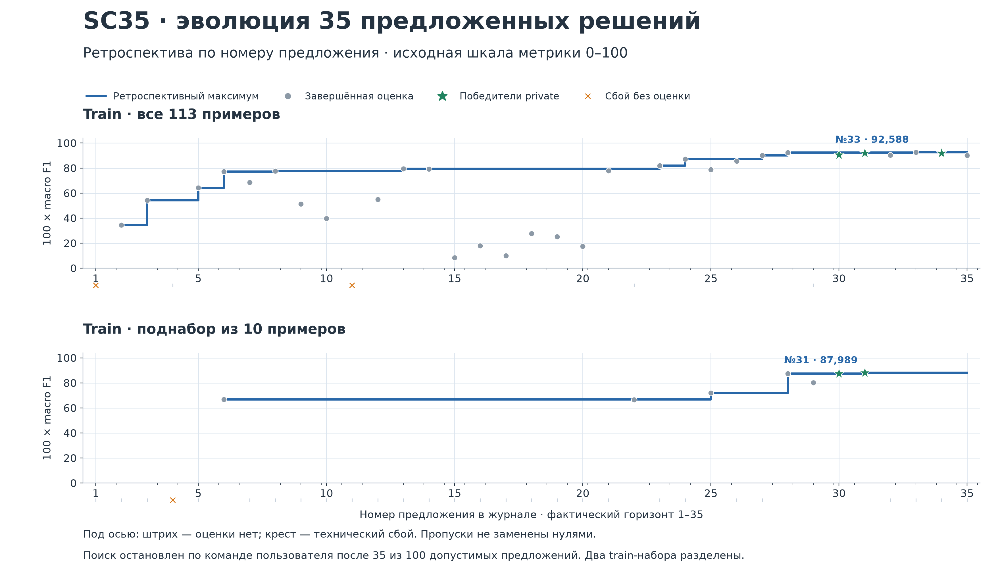
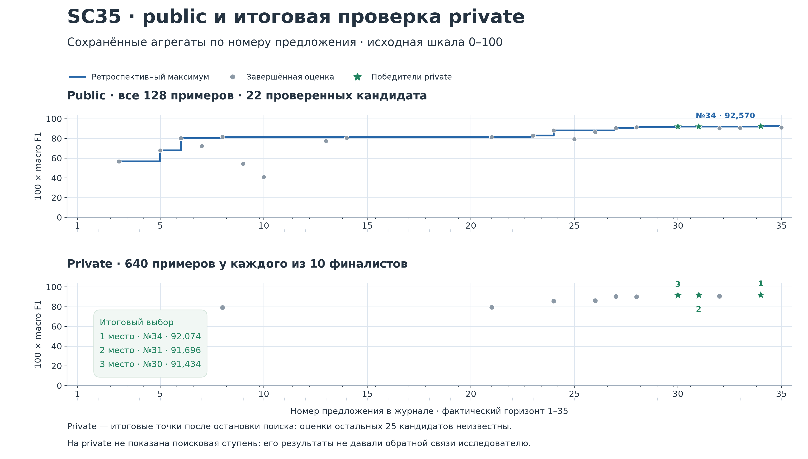
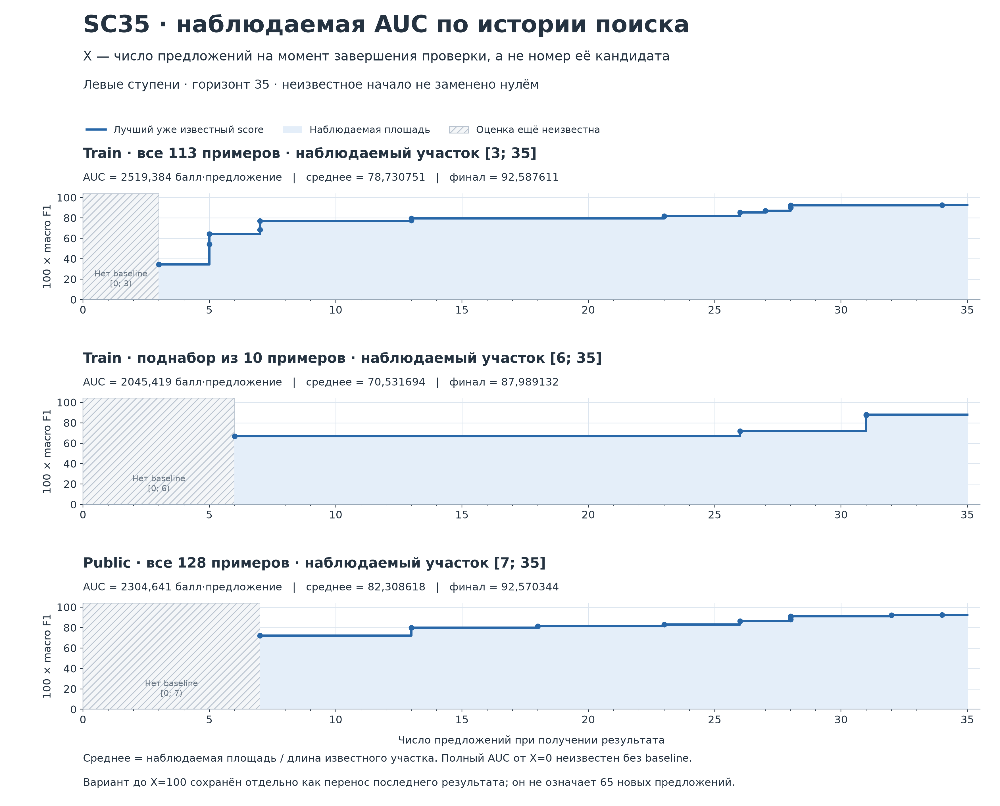

# SC 35 Результаты первого прогона

6 ноября 2026 года · Кампания sc35-first-20261028 · 35 предложенных решений из лимита 100

## 1 Выбор приватного оценщика

Private завершился 6 ноября в 14:41 МСК: десять финалистов проверены на 640 входах каждый, сохранены все 6400 результатов. Оценщик выбрал sem-v3-exp4-prompt, sem-v3-exp3-prompt и sem-v3-exp3-prec. Первое место получил sem-v3-exp4-prompt с 92,074036 балла из 100. Все три победителя сочетают формальные проверки DOCX с модельным содержательным этапом; лучший полностью немодельный финалист formal-exp4 занял четвёртое место с 90,481902. [S1]

| Место | Решение | Private | Основное отличие |
| --- | --- | --- | --- |
| 1 | sem-v3-exp4-prompt | 92,074036 | Поздние формальные проверки exp4 и уточнённый содержательный промпт |
| 2 | sem-v3-exp3-prompt | 91,695700 | Формальные проверки exp3 и та же линия уточнения промпта |
| 3 | sem-v3-exp3-prec | 91,434287 | Формальные проверки exp3 и ограничение модельных замечаний |

Лидер опередил второе место на 0,378336 балла, а второе — третье на 0,261413. Эти разницы описывают один прогон на данном наборе. Независимые повторения решателя и доверительные интервалы ранга не получены. Победитель private также имел лучший public-score среди 22 проверенных кандидатов; лучший полный train принадлежит другому варианту, sem-v3-exp4-prec. [S1, S2]

### Что проверяли

Задача — найти замечания к DOCX программы и методики испытаний по заданному профилю ЕСПД и типографики, указать категорию и точный фрагмент канонического текста. Ответ имеет схему sc35-span-review-v1: атомарные findings с Unicode-координатами [start, end), замечанием и основанием. Редакционная рекомендация сохраняет отличие от обязательного нормативного требования. Исправление самого документа в задачу не входит.

Набор содержит 881 вход: train 113, public 128 и private 640. Все варианты происходят от одной раскрытой ПМИ: разбиение удерживает разные повреждения этой ПМИ, а не независимые документы. Общий профиль содержит 113 правил — 99 нормативных и 14 редакционных, таксономия — 12 категорий. Эталоны покрывают заданные правила и области, поэтому балл не измеряет полноту проверки всей ЕСПД или готовность к экспертной приёмке нового документа. [S2, S6]

Основной балл — 100 × macro F1 активных категорий по всему выбранному набору. Для каждой категории сначала суммируются символьные пересечения, предсказанные и эталонные интервалы по всем примерам; затем рассчитывается F1 категории и среднее по активным категориям. Это не среднее F1 документов. Например, если в вымышленной категории найдены все четыре эталонных символа первого документа и пропущены двенадцать символов второго, среднее F1 документов равно 50%, а официальный корпусный результат — 100 × 2 × 4 / (4 + 16) = 40 баллов. [S6]

Оценка и агрегация полностью программные: LLM-судьи и судейских голосов нет. В генеративных ролях закреплена DeepSeek-V4-Flash-0731 с reasoning_effort=max. Hermes использовался внешним исследователем для разработки кандидатов. Все десять private-финалистов выбрали sc35-content — Python-конвейер, который вызывает внутреннюю модель для содержательной части, когда она включена в кандидате. [S1, S2, S3]

## 2 Все проверенные решения

Поиск остановлен по команде пользователя на 35 предложениях из 100; 65 мест остались неиспользованными. В каноническом журнале 62 завершённых измерения: 40 train, из них 37 успешных и три ошибочных, и 22 успешных public. Хотя бы один успешный train-замер получили 32 кандидата, полный train из 113 входов — 30. Полный train проверялся 32 раза, срез из десяти train-входов — восемь раз; результаты среза не подставляются вместо полного набора. Private проверил один принятый пакет из десяти финалистов. [S1, S2]

В таблице приведён весь private-пакет. Короткие имена получены удалением общего префикса sc35-; номер — порядок регистрации в журнале. Баллы округлены до трёх знаков, итоговый ранг определён по исходным значениям. Все десять финалистов имели существовавшие до остановки ревью точных снимков и были разрешены операторским свидетельством отбора. [S1, S2, S3]

| Ранг | № | Кандидат | Train 113 | Public 128 | Private 640 |
| --- | --- | --- | --- | --- | --- |
| 1 | 34 | sem-v3-exp4-prompt | 91,937 | 92,570 | 92,074 |
| 2 | 31 | sem-v3-exp3-prompt | 91,815 | 92,120 | 91,696 |
| 3 | 30 | sem-v3-exp3-prec | 90,636 | 92,128 | 91,434 |
| 4 | 32 | formal-exp4 | 90,280 | 90,455 | 90,482 |
| 5 | 27 | formal-exp3 | 90,142 | 90,392 | 90,431 |
| 6 | 28 | sem-v3-exp3 | 92,362 | 91,253 | 90,137 |
| 7 | 26 | formal-exp2 | 85,482 | 86,449 | 86,235 |
| 8 | 24 | sem-v3-exp | 87,189 | 88,041 | 85,622 |
| 9 | 21 | sem-v3-prec | 77,750 | 81,280 | 79,517 |
| 10 | 8 | sem-v3 | 77,608 | 81,467 | 79,079 |

Ошибка измерения и отсутствие проверки не означают нулевое качество. Неудачными были исходный baseline-hybrid на полном train, sem-v1 на срезе из десяти входов и sem-nocanon на полном train. Ни один из этих неудачных запусков не вошёл в private-пакет. [S2]

Лучший полный train получил sem-v3-exp4-prec — 92,587611, но его public составил 90,618796. У него, sem-v3-exp4-base, sem-v3-prec2 и sem-v3-prec3 не было требуемого существовавшего ревью точного снимка, поэтому отбор после команды остановки их не дополнял новыми ревью. Это сохранение процедуры допуска, а не новое признание этих методов неработоспособными. [S2, S3]

## 3 Как появились кандидаты

### Что считалось кандидатом

Зафиксированная модель не менялась. Кандидат — сохранённая версия Python-решателя, его дополнительных проверок и инструкции содержательной модели. Из 35 предложений возникли две связанные линии: детерминированные проверки DOCX и гибриды, которые добавляют к ним один содержательный запрос LLM. Внешний исследователь работал в Hermes, а все десять private-финалистов выбирают программный харнес `sc35-content`.

Исходный метод объединяет граф требований, формальные свойства OOXML, редакционную типографику и содержательную LLM. Профиль содержит 113 правил — 99 нормативных и 14 редакционных; модель получает 40 выбранных правил и полный канонический текст с абзацами. Она возвращает assessments по каждому правилу и локализованные замечания с дословными цитатами. Координаты задаются в Unicode code points, `[start,end)`, по XML-проекции DOCX. Оценщик после этого считает фиксированное пересечение интервалов по категориям без обращения к модели.

Ниже описаны фактические изменения неизменяемых снимков. Объяснение предполагаемого эффекта остаётся гипотезой автора. Более высокий балл одного запуска не доказывает причинность изменения или устойчивый порядок на произвольных новых документах.

### От исходного гибрида к работающему формальному основанию

№1 `sc35-baseline-hybrid` регистрирует исходный метод без изменений. Его полный train завершился технической ошибкой и не дал качества; подставлять вместо отсутствующего балла ноль неверно. №2 `sc35-baseline-formal` отключает создание клиента модели, сохраняя граф, формальные проверки и типографику. Так появляется дешёвый измеряемый вариант для последующих изменений. Нулевые модельные токены здесь следуют из отсутствия запроса, а не из пропуска измерения.

№3 `sc35-formal-v1` добавляет `extra_checks.py`. Он узнаёт обозначения титула, поля аннотации и содержания, наличие титульной части и сравнивает финальную секцию с постоянной конфигурацией исходной ПМИ. Это новый программный источник находок, а не другой промпт. Его константы размеров листа и полей выведены из открытого train одной ПМИ; проверка выбирает только одно расхождение секции по фиксированному приоритету. Такой механизм может успешно локализовать повреждение знакомого шаблона, но не доказывает нормативную правильность любой другой конфигурации документа.

№5 `sc35-formal-v2` расширяет этот слой заголовками и их отступами, нумерацией рисунков, оформлением приложения и двоеточием после «где». №7 `sc35-formal-v3` исправляет разбор хвоста обозначения и добавляет порядок перечней терминов и рисунков. Одновременно удаляется ненадёжная проверка последовательности заголовков. Это существенный отрицательный результат: предполагаемое правило признано слишком рискованным в данной реализации; требование стандарта при этом не меняется.

### Чтобы ошибка координаты не уничтожала все находки

Ранние гибриды решали отдельную инженерную задачу — как сохранить содержательные ответы модели в точной координатной системе. №4 `sc35-sem-v1` добавляет tolerant-нормализатор: при несовпадении чисел и цитаты он пытается найти цитату в каноническом тексте, а потерявшее координаты нарушение переводит в `insufficient_context`. Однако первая реализация имела ошибку: единственное найденное вхождение с неверной модельной координатой могло получить позицию −1. №6 `sc35-sem-v2` исправляет этот случай и вводит окончательную защиту от недопустимых интервалов. Это исправление реализации, а не подтверждение новой гипотезы проверки ЕСПД.

Дословная цитата помогает восстановить уникальное место, но не решает неоднозначность повторов. Измеренный резолвер проверяет только первое и второе вхождения на попадание в предложенный моделью интервал; если подходящего нет, выбирает первое. Поэтому слова «точная цитата» нельзя подменять обещанием «всегда однозначно выбранный объект». Поведение сохранено в поздних гибридах и победителе.

Другая защита расположена вокруг всего содержательного этапа: `run_baseline` перехватывает любое его исключение и продолжает с инструментальными находками. Это может сохранить правильный по схеме формальный review после транспортного сбоя или ошибки разбора LLM. При таком пути `semantic_stage_enabled=false`, а собственный флаг `llm_called` также становится `false`, даже если попытка уже расходовала токены. Поэтому корректно завершённый пример не означает автоматически успешный содержательный этап; стоимость и число обращений следует читать из gateway, а не из этого флага.

№8 `sc35-sem-v3` соединяет исправленный семантический слой с дополнениями formal-v3. №12 `sc35-sem-robust-base` оставляет восстановление координат и подавление ошибок, но возвращается к исходному набору формальных проверок. Так контролируется вклад нового `extra_checks`, а не создаётся третья самостоятельная архитектура.

### Что показали абляции

№9 `sc35-formal-nocanon` пытается убрать зависимость от выученной конфигурации: отключает сравнение секции, грамматику титульных обозначений и проверки выравнивания/начала приложения. Однако конкретный отступ подраздела 360 twips остаётся. Это частичная абляция шаблонных правил, а не решение без таких предположений.

№11 `sc35-sem-nocanon` не дал корректного измерения: вызов уже передаёт `canonical=False`, а `build_review` ещё не принимает этот аргумент. Ошибка возникает до LLM; в журнале нулевой модельный расход. №13 добавляет недостающий параметр и восстанавливает запуск, но заявленную полную абляцию не завершает: `canonical` отключает лишь отступ подраздела, тогда как секция, обозначения и приложения всё ещё проверяются безусловно. Называть №13 проверкой переноса без канонических констант было бы неточно.

№10 `sc35-extra-only` выдаёт только новые формальные находки, минуя исходные граф, формат, типографику и LLM. Несмотря на родителя `formal-nocanon`, этот вариант явно включает `canonical=True`; одновременно меняются состав этапов и применение констант. Напротив, №15–20 запускают весь исходный детерминированный baseline и лишь после этого оставляют или исключают findings по `source_stage`. Они сравнивают вклад групп находок в оценку, но их время не является временем одного изолированного модуля: остальные проверки уже были выполнены.

### Что меняли в инструкции модели

№14 `sc35-sem-v3-prompt` перечисляет проверяемые группы: содержимое разделов, ссылки, термины и сокращения, формулы и размерности, рисунки, таблицы и приложения. Он одновременно задаёт осторожное предположение о редкости дефектов и требует минимальной дословной цитаты. Условный ярлык «полюс полноты» отличает его от ещё более строгого воздержания, но не означает безусловную команду выдавать больше замечаний.

№21 `sc35-sem-v3-prec` просит считать нарушением только однозначный случай и при сомнении предпочитать `pass` или `insufficient_context`. №22 добавляет к нему весь перечень групп, выделяя формулы как проверяемые по цитате случаи; эта версия измерена лишь на десяти train-примерах. Её число нельзя включать в ряд полного train из 113 документов. №25 делает более узкую попытку вернуть только формульные случаи. На public она уступила исходному prec: 79,203 против 81,280. Это сохранённый отрицательный результат, а не основание объявить любую более подробную инструкцию хуже.

Поздний №29 добавляет уже другой акцент — минимизацию интервала: не обводить целый список или раздел, если проблема локализуется одной строкой, не добавлять дальний второй якорь. Это мягкая инструкция модели. Программного алгоритма, который гарантированно обрезает все ответы до оптимального span, в таком изменении нет.

### Расширение формальных проверок

№23 `sc35-formal-exp` расширяет исполнимый формальный набор: пустые поля и отсутствие обязательных разделов, название и сноски таблицы, номер display-формулы, абзацный отступ, оформление и нумерация заголовков. Также исправляется чтение XML-значения `pageBreakBefore=false`. №24 переносит точный `extra_checks.py` в гибрид с прежней нейтральной семантической инструкцией.

Расширение не является универсальным доказателем стандарта. Оно узнаёт конкретные подписи пустых полей, а проверка отсутствующего раздела целиком отключается при наличии маркера «Дополнительный материал испытания» среди прямых абзацев тела. Это адаптация к устройству набора и одной исходной ПМИ. В коде не используется lookup готового ответа по `case_id`, но отсутствие такого lookup не отменяет зависимости от шаблона и состава синтетических повреждений. Заявления автора о нулевом риске ложных находок следует читать как наблюдение на проверенном train, а не гарантию для новых документов.

№26 `sc35-formal-exp2` добавляет порядок пояснений букв в формуле, ссылку «рис. N» и отсутствие упоминания пронумерованного приложения. №27 `sc35-formal-exp3` уточняет титул до аннотации и распознавание обозначения, добавляет интервалы структурных заголовков, регистр названия программы, маркер сноски и перечисление приложений в содержании. №28 переносит эти проверки в нейтральный гибрид. Получается лестница исполнимых предикатов, к которой отдельно присоединяют одну и ту же семантическую модель.

### Что именно изменили три победителя

№31 `sc35-sem-v3-exp3-prompt` соединяет третью расширенную формальную серию с перечисляющим правила промптом №14. От нейтрального №28 отличается только `SKILL.md`; Python-код, профиль и модель сохраняются. На private он занял второе место с 91,695700.

№30 `sc35-sem-v3-exp3-prec` использует ту же формальную серию exp3, но переносит точный промпт строгого воздержания №21. Он занял третье место с 91,434287. Это альтернативная инструкция той же содержательной модели на том же инструментальном основании, а не иной агентский харнес.

№32 `sc35-formal-exp4` добавляет две проверки формул: явное левое выравнивание одной пронумерованной MathML-формулы при правом выравнивании другой и простой номер формулы при совместном наличии явного контекста части N и формулы с префиксом `(N.M)`. Эти ограничения призваны воздерживаться без достаточных сигналов, но рендер не выполняется, а ложные срабатывания на другом оформлении остаются возможны.

Победитель №34 `sc35-sem-v3-exp4-prompt` переносит только этот `extra_checks.py` в №31. Его перечисляющая инструкция и содержательный код остаются прежними. На private он получил 92,074036. Таким образом, первое и второе места различаются двумя формальными предикатами, а второе и третье — формулировкой семантической инструкции. Один прогон не измеряет дисперсию этих различий.

№33 переносит exp4 на строгий prec-промпт, но на public результат оказался ниже прежнего exp3-prec; причина такого расхождения не установлена. №35 возвращает нейтральный промпт на набор exp4. Оба измерены, однако не вошли в private, поскольку к команде остановки не имели существовавшего ревью точного снимка; новые ревью после остановки не создавались. Самый поздний номер не гарантировал ни лучшего переноса, ни допуска в финал.

### Один вымышленный пример

Представим DOCX с фразой «Документ относится к части 2», правовыровненными MathML-формулами `E=U/R (2.1)` и `P=UI (3)`, а также строкой `где: R — сопротивление`. Это искусственная иллюстрация механизма, не вопрос/документ private и не сохранённый ответ модели.

Ранняя формальная серия может заметить двоеточие после «где». Exp4 видит одновременно контекст части 2, номер `(2.1)` и простой `(3)` и привязывает замечание к строке второй формулы. Содержательная модель независимо проверяет переданные требования; перечисляющий промпт напоминает явно рассмотреть формулы, строгий prec-промпт усиливает воздержание при неоднозначности. Если модель ошиблась в числовых координатах уникальной цитаты `где: R — сопротивление`, нормализатор находит её в каноническом тексте. Если цитата повторяется, описанная эвристика может выбрать неверный объект, хотя сама цитата останется дословной.

### Как читать эту историю

Рост обеспечивала не одна формулировка «проверять лучше». Отдельно исследовались покрытие исполнимых OOXML/текстовых правил, устойчивость обработки модельного ответа, минимизация интервалов и степень семантического воздержания. Часть предложений — инженерные исправления, часть — абляции и отрицательные варианты. Все они расходуют места в лимите и сохраняются в родословной.

Корпус содержит 881 вариант одной раскрытой ПМИ; split удерживает повреждения, а не независимые исходные документы. Находки оцениваются в зафиксированных областях по категориям и символьным интервалам; истинность свободного текста обоснования метрика не проверяет. Поэтому данный прогон измеряет качество локализации контролируемых повреждений этого семейства. Полнота проверки ЕСПД и перенос на любые ПМИ остаются за пределами измерения. [S3, S6] Описания сверены с `source/snapshots`, журналом `source/history.json` и сохранёнными ревью; новых модельных запросов и повторных измерений для отчёта не было.

## 4 Стоимость приватной проверки

Токены приведены в миллионах, суммы длительностей — в часах. Время решателя включает подготовку внутри примера и технические повторы. Время программной метрики хранится отдельно; ноль её токенов является полным учётом. Это суммы операций по всем 640 входам каждого кандидата, а не календарная длительность всей private-серии. [S1, S4]

| Решение | Решатель млн токенов | Решатель ч | Метрика млн токенов | Метрика ч |
| --- | --- | --- | --- | --- |
| sem-v3-exp4-prompt | 69,447* | 37,63 | 0 | 0,13 |
| sem-v3-exp3-prompt | 70,419* | 43,35 | 0 | 0,13 |
| sem-v3-exp3-prec | 65,793* | 36,36 | 0 | 0,13 |
| formal-exp4 | 0,000 | 0,46 | 0 | 0,13 |
| formal-exp3 | 0,000 | 0,47 | 0 | 0,13 |
| sem-v3-exp3 | 68,642* | 46,76 | 0 | 0,13 |
| formal-exp2 | 0,000 | 0,45 | 0 | 0,13 |
| sem-v3-exp | 68,624 | 35,69 | 0 | 0,13 |
| sem-v3-prec | 66,336* | 25,82 | 0 | 0,13 |
| sem-v3 | 68,941 | 31,11 | 0 | 0,13 |

Звёздочка означает неполный учёт токенов решателя: шесть попыток без usage у sem-v3-exp4-prompt, пять у sem-v3-exp3-prompt, пять у sem-v3-exp3-prec, шесть у sem-v3-exp3 и одна у sem-v3-prec. Их время сохранено, неизвестные токены не приравниваются к нулю.

Всего на private учтено 478,202437 млн токенов решателей; это нижняя граница из-за 23 попыток без usage. Сумма длительностей решателей — 258,09 часа, программной метрики — 1,29 часа. Три формальных финалиста не обращались к модели и имеют нулевой модельный расход при измеренном ненулевом времени исполнения. [S1, S4]

Наиболее заметный ресурсный выбор — между лидером и formal-exp4. Формальный вариант уступил 1,592134 балла, получил 90,481902 без модельных токенов и затратил 0,46 часа решателя против 37,63 часа у победителя, то есть примерно в 82 раза меньше суммарного времени решателя на тех же 640 входах. У победителя дополнительно неизвестен расход шести попыток. Это наблюдаемое соотношение качества и затрат; оно не доказывает перенос той же разницы на новые ПМИ. [S1, S4]

## 5 Где различались результаты

В таблице показан символьный F1 категорий, умноженный на 100, для тройки победителей и лучшего формального финалиста. Заголовки exp4-prompt, exp3-prompt и exp3-prec сокращают имена sem-v3-exp4-prompt, sem-v3-exp3-prompt и sem-v3-exp3-prec. Счётчики каждой категории суммированы по всем 640 входам; её F1 не является средним результатов документов. [S1, S6]

| Категория | exp4-prompt | exp3-prompt | exp3-prec | formal-exp4 |
| --- | --- | --- | --- | --- |
| Разделы и обязательные сведения | 97,113 | 94,911 | 95,210 | 100,000 |
| Реквизиты и обозначения | 99,242 | 93,438 | 90,345 | 100,000 |
| Аннотация и содержание | 98,962 | 100,000 | 100,000 | 100,000 |
| Параметры страниц | 100,000 | 100,000 | 100,000 | 100,000 |
| Заголовки | 100,000 | 100,000 | 100,000 | 100,000 |
| Абзацы, шрифты и списки | 79,444 | 77,591 | 78,057 | 100,000 |
| Рисунки | 61,267 | 62,040 | 62,434 | 62,434 |
| Формулы | 97,138 | 96,213 | 97,058 | 98,493 |
| Таблицы | 100,000 | 100,000 | 100,000 | 100,000 |
| Примечания и сноски | 100,000 | 100,000 | 100,000 | 100,000 |
| Ссылки, термины и сокращения | 71,721 | 76,156 | 74,108 | 24,855 |
| Приложения | 100,000 | 100,000 | 100,000 | 100,000 |

У победителя наиболее слабые категории — рисунки (61,267), ссылки, термины и сокращения (71,721), абзацы, шрифты и списки (79,444). По рисункам высокая символьная precision 94,249% сочетается с recall 45,385%: главная потеря здесь — пропуски покрытого эталона. Для ссылок, терминов и сокращений recall равна 57,756% при precision 94,595%. В абзацах и списках recall достигла 100%, но precision 65,899% показывает избыточную ширину или объём учитываемых предсказаний. Эти символьные показатели относятся к области фиксированного покрытия, а не к достоверности всех текстовых объяснений. [S1]

При сравнении с formal-exp4 основное повышение F1 наблюдается в ссылках, терминах и сокращениях: 24,855491 → 71,721311. При этом абзацы и списки снизились со 100 до 79,444444, рисунки — с 62,433862 до 61,266874, формулы — с 98,493472 до 97,138458. Один лучший общий балл не означает улучшения каждой категории. [S1]

Объединённый по символам micro F1 победителя равен 95,629851%, а formal-exp4 — 96,005779%. При этом официальный macro F1 даёт им 92,074036 и 90,481902 балла соответственно. Такое различие закономерно: micro сильнее зависит от объёма размеченного текста, macro одинаково взвешивает активные категории. Официальный отбор использует macro и не заменяется более выгодным для отдельного кандидата диагностическим показателем. [S1, S6]

В 640 review победителя зарегистрировано 219 362 замечания out_of_scope; они присутствуют во всех 640 входах и исключены замороженной метрикой из основного счёта. Ещё 141 finding отмечен дубликатом, в 115 review. Число out_of_scope не означает столько же доказанных ложных замечаний: вне размеченного покрытия метрика не имеет эталона для такого вывода. Одновременно высокий итоговый балл не устанавливает precision всего выдаваемого списка или его удобство для эксперта. Отдельная проверка полноты и корректности замечаний вне покрытия не проводилась. У formal-exp4 также есть 215 472 out_of_scope-находки; его высокая точность внутри оцениваемых областей не означает 100% достоверности всего списка. [S1, S6]

При пересечении оцениваемой области слишком широкий интервал учитывается целиком, а не обрезается до эталона; это снижает точность. Полностью внешняя находка либо находка по исключённому для этого примера правилу относится к out_of_scope. Пересекающиеся находки одной категории объединяются по символам, а совпадающие пары категории и интервалов удаляются как дубликаты. Дополнительное сопоставление событий по IoU ≥ 0,5 не определяет итоговый ранг. [S6]

### Что можно рекомендовать по этому прогону

Сохранить sem-v3-exp4-prompt как первый итоговый вариант, а sem-v3-exp3-prompt и sem-v3-exp3-prec — как остальные два выбранных оценщиком решения. Для сценария, где модельный расход критичен, отдельно рассматривать formal-exp4: его измеренная потеря составляет 1,592134 балла при нулевых модельных токенах и существенно меньшем времени решателя. Перенос любого из этих вариантов на новые ПМИ требует проверки другой вёрстки, новых исходных документов и замечаний вне нынешнего эталонного покрытия.

## 6 Ход прогона и границы выводов

Все даты и время приведены по Москве. Поиск стартовал 28 октября в 11:17:41; первое предложение зарегистрировано в 11:22:11. После анализа train появились формальные исправления, содержательные варианты, абляции и поздние комбинации формальных проверок с промптами. Модель, её effort, профиль исполнения, split и метрика в кампании сохранялись. [S2, S7]

30 октября в 19:12:45 внешний исследователь завершился после шести HTTP 500 от модельного сервера. 31 октября в 11:38:55 поиск продолжили в новом контейнере с прежним журналом, снимками и рабочими файлами; внешний учёт связали с прежним запуском. Сохранённый public-результат прочитали и закрыли существующую запись журнала без нового измерения кандидата. [S7]

2 ноября в 18:14:29 пользователь штатно остановил поиск. Новые предложения, проверки и ревью не начинались; завершили только уже выполнявшуюся public-проверку. На накопленных свидетельствах отобрали десять финалистов, а 3 ноября в 00:49:34 зафиксировали финализацию. Поиск не использовал оставшиеся 65 мест, поэтому его нельзя описывать как полностью выполненную кампанию из ста эволюций. [S2, S3, S7]

В ночь на 3 ноября начался private. Первоначальный координатор выполнял финалистов последовательно, хотя общий пул содержал четыре слота. По отдельной команде пользователя в ядро добавили параллельное выполнение private-финалистов, штатную паузу и продолжение по сохранённым префиксам. Старый runtime завершил активный пример, следующая техническая попытка была остановлена до создания runner и модельного запроса. Сохранили все 246 готовых ответов, прежний допуск и измерения; одну техническую попытку с нулём модельных обращений учли отдельно от качества. [S7]

Продолжение того же пакета запущено 3 ноября в 14:13:25. Проверка переключения в 15:15:21 подтвердила четыре одновременно работающих финалиста и четыре занятых слота; примеры внутри каждого финалиста оставались последовательными. После завершения восьми кандидатов два оставшихся исполнялись параллельно. Private закончил вычисления 6 ноября в 14:41:18 и выбрал три решения. Процесс продолжения закончил служебную работу в 15:48:32 с кодом 0. Финальное вычислительное состояние сохранено; незавершённая доставка части private-записей в MLflow описана отдельно в разделе 10. [S1, S7]

### Сопоставимость и пределы интерпретации

Полный train и десятиэлементный срез перекрываются; они имеют разные ключи сопоставимости и получают отдельные таблицы и кривые. Кеш уже измеренных ответов может использоваться при проверках одного снимка на пересекающихся срезах. Эти результаты не являются независимыми повторениями решателя и не усредняются с public или private как равноценные независимые измерения. [S2, S5]

Все 881 вход происходят от одной ПМИ. Формальные проверки обучались по открытому train и содержат конкретные канонические свойства этого шаблона, а некоторые поздние правила учитывают устройство внесённых повреждений. Отсутствие прямого поиска ответа по case_id не устраняет такой зависимости. Высокий private измеряет перенос на удержанные повреждения данной ПМИ; независимые документы, полнота ЕСПД, устойчивость к другой вёрстке и экспертная пригодность этим прогоном не установлены. [S3, S6]

Допуск означает соответствие сохранённым условиям и ревью точного снимка; он не устраняет риск настройки на train. Названия nocanon не принимаются как доказательство полной очистки от канонических свойств: соответствующие абляции меняли только часть поведения, одна версия оказалась нефункциональной. Новые решения о допуске и новые модельные оценки при подготовке отчёта не создавались. [S3]

Модельный этап может завершиться внутренней ошибкой, после которой код возвращает формальный review. Поэтому 6400 сохранённых результатов и отсутствие ошибки серии не означают 6400 успешных содержательных модельных разборов. Свободный текст замечания также не получает независимой нормативной оценки: основная метрика проверяет категорию и локализацию. [S3, S4, S6]

## 7 Эволюция кандидатов

Полный train из 113 входов и срез из десяти показаны раздельно. Каждая точка относится к измерению конкретного неизменяемого кандидата; отсутствие оценки и ошибка не превращаются в нулевой балл. Лучший полный train — 92,587611 у sem-v3-exp4-prec, лучший результат на срезе — 87,989132 у sem-v3-exp3-prompt. Срез служил разработке, а не отдельным закрытым набором. [S2, S5]

### Public и private

Public проверил 22 кандидата и направлял поиск только общим score. Его лидер sem-v3-exp4-prompt с 92,570344 стал также первым на private с 92,074036. Private-точки показаны ретроспективно: их расположение рядом с номерами предложений не означает, что закрытые результаты были известны при разработке этих версий. Private не давал обратной связи для продолжения поиска. [S1, S2, S5]

## 8 AUC поиска

AUC рассчитан по официальным curve-экспортам канонического журнала и независимо пересчитан. Ось X — число уже предложенных решений в момент завершения измерения, а не номер проверяемого кандидата. Например, результат ранней версии, полученный после регистрации нескольких потомков, улучшает кривую только с момента своего появления. Ошибки расходуют места предложений, но не добавляют нулевого качества. Ступень после события действует до следующего события. [S2, S5]

### Численный расчёт AUC

| Набор | Наблюдаемый X | Площадь балл × предложение | Среднее на участке | Лучший итоговый балл |
| --- | --- | --- | --- | --- |
| Train 113 | 3–35 | 2519,384031 | 78,730751 | 92,587611 |
| Train 10 | 6–35 | 2045,419120 | 70,531694 | 87,989132 |
| Public 128 | 7–35 | 2304,641317 | 82,308618 | 92,570344 |

До начала поиска не был задан измеренный baseline. Поэтому участки от нуля до первого результата остаются неизвестными, полный AUC и среднее на всём горизонте 0–35 имеют значение null. Таблица описывает только наблюдаемый участок: его длина равна 32, 29 и 28 предложениям соответственно. Среднее под кривой остаётся на шкале 0–100 и не является вероятностью правильного ответа. [S5]

В этой кампании все 22 public-измерения находятся в каноническом журнале и имеют события завершения, поэтому public AUC рассчитывается. Private AUC поиска не рассчитывается: закрытые результаты не направляли поиск. Площади разных наборов не усредняются. Горизонт соответствует фактическим 35 предложениям; оставшиеся 65 мест лимита не объявляются проведёнными экспериментами. Кривые включают исторические версии, использовавшие train и имеющие связанные с этим ограничения. [S2, S3, S5]

## 9 Расход токенов всего запуска

Кампания из 35 предложенных решений потребовала не менее **1 096 064 019 токенов**: 863 146 809 входных и 232 917 210 выходных. В сумму входят оба запуска внешнего исследователя, решатели train, public и private, неудачные обращения и технические повторы. У 120 модельных попыток отсутствует usage, поэтому это подтверждённая нижняя граница. Денежная стоимость не рассчитывалась. [S4]

| Роль | Входные токены | Выходные токены | Всего |
| --- | ---: | ---: | ---: |
| Арена и исследователи | 267 237 416 | 1 437 510 | 268 674 926 |
| Решатели | 595 909 393 | 231 479 700 | 827 389 093 |
| Программная метрика | 0 | 0 | 0 |
| Итого | 863 146 809 | 232 917 210 | 1 096 064 019 |

Внешний исследователь разрабатывает кандидатов, анализирует train и организует проверки. Решатель обрабатывает переданный документ и при включённом содержательном этапе обращается к той же закреплённой модели. Метрика запускает детерминированный код и не расходует LLM-токены. Ресурсы разработки кандидатов не прибавляются к этим группам повторно.

| Раздел | Решатели | Метрика | Сумма |
| --- | ---: | ---: | ---: |
| Train | 172 307 366 | 0 | 172 307 366 |
| Public | 176 879 290 | 0 | 176 879 290 |
| Private | 478 202 437 | 0 | 478 202 437 |
| Итого оценивание | 827 389 093 | 0 | 827 389 093 |

#### Как исключён двойной счёт

Первичный источник — доверенные счётчики gateway по уникальным run_id. Сверены 12 639 внутренних scope и два внешних запуска исследователя; множества не пересекаются. Число попыток и суммы токенов для каждого scope независимо сопоставлены с метаданными всех 9809 модельных обращений. Все найденные модельные попытки отнесены к ролям кампании; счётчики закрыты, активных запросов нет. Один внутренний scope без прямой ссылки из записи измерения имеет ноль попыток и ноль токенов и не меняет итог. [S4]

При пересечении полного train и срезов обнаружено 50 повторных ссылок на уже сохранённые примеры решателя и 50 соответствующих копий измерений программной метрики. В общих ресурсных суммах они учтены один раз. У неудачного baseline-hybrid в resources отсутствовал run_id; связь с единственным сохранённым scope восстановлена по совпадению всех счётчиков и попаданию временного интервала запроса в интервал измерения. Его 104 583 токена уже входят в train и не прибавляются второй раз. [S4]

Повторный экспорт в MLflow, копирование трейса и восстановление private не создают нового расхода. Прежние 246 private-ответов не генерировались повторно; техническая попытка остановки с нулём модельных обращений сохранена отдельно с собственным временем. Заявленные при регистрации расходы подготовки относятся к разработке и перекрываются с работой внешнего исследователя, поэтому не добавляются поверх gateway. [S4, S7]

#### Границы суммы

Часть ответов модели или сетевых попыток не содержит usage; неизвестные токены не заменяются нулём и не восстанавливаются приблизительной токенизацией. В сумму входят ошибочные обращения, для которых usage известен. Синтетические приёмочные счётчики и работа операторского чата и агентов сопровождения вне двух доверенных запусков исследователя не являются измеренным расходом этой канонической кампании. Число 1 096 064 019 нельзя называть полной стоимостью всей подготовки, ремонтов и составления отчёта.

#### Время

От запуска 28 октября в 11:17:41 до завершения private 6 ноября в 14:41:18 прошло **9 дней 3 часа 23 минуты**. В этот срок входят поиск, ожидание модели, технические повторы, перерыв перед возобновлением и private. После продолжения private 3 ноября в 14:13:25 до его окончания прошло **3 дня 27 минут 53 секунды**. [S4, S7]

| Величина | Часы | Что измерено |
| --- | ---: | --- |
| Календарный срок кампании | 219,39 | От первого запуска исследователя до завершения private |
| Сумма длительностей внешних исследовательских запусков | 202,96 | Два контейнера, включая паузу и ожидание private |
| Сумма длительностей решателей | 485,13 | Дедуплицированные примеры train/public/private с подготовкой и повторами |
| Сумма длительностей программной метрики | 3,87 | Проверка и агрегация, с удалением повторных кешированных измерений |
| Сумма длительностей модельных запросов всех ролей | 475,25 | От отправки до завершения каждой попытки |

Длительности перекрываются: запросы входят во время решателей и исследователя, а кандидаты выполнялись параллельно. Поэтому строки не складываются в календарный срок и не являются GPU-часами. Отдельные время вычисления модели и время ожидания её очереди не измерялись. [S4]

## 10 Ошибки обращений и неизвестный расход

Зафиксированы **9809 модельных попыток: 9513 успешных и 296 ошибочных**. У 120 ошибочных попыток отсутствует usage. Ещё 176 ошибочных попыток вернули счётчики, и этот расход включён в общую сумму. Ошибка модельной попытки, ошибка всей проверки кандидата и возврат формального результата после локальной ошибки содержательного модуля — разные единицы учёта. [S4]

| Роль и раздел | Все попытки | Ошибки | Без usage |
| --- | ---: | ---: | ---: |
| Арена и исследователи | 1 801 | 45 | 45 |
| Решатель train | 1 680 | 67 | 25 |
| Решатель public | 1 718 | 54 | 27 |
| Решатель private | 4 610 | 130 | 23 |
| Итого | 9809 | 296 | 120 |

Диагностика объясняет все 296 ошибок: 176 ошибок валидации ответа модели, 88 HTTP 500, десять HTTP 503, двадцать ConnectError и два TimeoutError. Все 120 попыток без usage относятся к HTTP 500/503, подключению и таймаутам. Ошибки валидации сохранили usage; HTTP 200 сам по себе не означает соблюдения требуемого контракта ответа. [S4]

#### Формальный результат после ошибки содержательного этапа

На private семь гибридов получили 4480 успешных модельных ответов и ещё 130 ошибочных попыток, всего 4610 обращений. Однако после 30 из этих успешных ответов содержательный этап локально не завершился: код перехватил исключение и сохранил формальный review с semantic_stage_enabled=false. У победителя таких примеров семь из 640; у второго места — три, у третьего — пять. [S1, S4]

| Гибридный финалист | Успешно включён содержательный этап | Возврат формальной части после модельного ответа |
| --- | ---: | ---: |
| sem-v3-exp4-prompt | 633 | 7 |
| sem-v3-exp3-prompt | 637 | 3 |
| sem-v3-exp3-prec | 635 | 5 |
| sem-v3-exp3 | 635 | 5 |
| sem-v3-exp | 637 | 3 |
| sem-v3-prec | 635 | 5 |
| sem-v3 | 638 | 2 |

Эти 30 примеров не добавляют 30 ошибок к 296 ошибочным gateway-попыткам: их успешные запросы уже входят в 4480 private-ответов и измеренный расход. В сохранённом ответе у всех тридцати собственный флаг llm_called=false, хотя доверенные ресурсы и метаданные вызовов подтверждают обращение к модели. Поэтому этот флаг нельзя использовать как источник стоимости. Причина локального исключения в измеренном коде не сохранялась; объявлять её конкретной транспортной или HTTP-ошибкой оснований нет. [S4]

Сам набор private завершён корректно по контракту оценки: формальный review является результатом измеренного кандидата, а не пропущенным примером. Ранг включает фактическое поведение с такими возвратами. Предположение, что все 640 содержательных разборов каждого гибрида успешно завершились, расходилось бы с сохранённой диагностикой.

#### Состояние доставки в MLflow

По операторскому срезу 6 ноября в 22:34:54 оба MLflow отвечают HTTP 200. Все 40 train-записей, 22 public-записи и два исследовательских отчёта доставлены каждому из предусмотренных получателей. У private/operator из 11 записей очереди две имеют exported, девять — tracking_pending с сохранённым ConnectionError. Записи очереди включают историю экспорта; их число не является числом финалистов или новых private-проверок. [S7]

Контейнер продолжения private завершился с кодом 0 в 15:48:32, внешний исследователь — в 14:41:39. Исследовательский отчёт имеет trace_complete и подтверждённый экспорт обоим получателям. У монитора на момент среза 34 перезапуска, а flush-progress остаётся устаревшим; причину перезапусков этот срез не устанавливает. Поэтому завершение вычислений и сохранность канонических результатов подтверждены, полная доставка private в MLflow — ещё нет. Числа отчёта взяты из канонического состояния, доверенных счётчиков и сохранённых метаданных вызовов; успешный HTTP health не подменяет проверку доставки. [S1, S4, S7]

## Приложение Все 35 предложенных решений

Указаны все зарегистрированные версии, включая технически неудачные и абляции. Короткое имя в таблице имеет общий префикс sc35-; родители обозначены номерами предложений. Train 113 и Train 10 разделены. «Ошибка» означает измерение без численного score, «—» — отсутствие такой проверки. Private известен только у десяти финалистов. Описания сверены с фактическим кодом, а не только с названиями или первоначальными гипотезами. [S1, S2, S3]

| № | Кандидат | Родители № | Метод | Train 113 | Train 10 | Public 128 | Private 640 |
| --- | --- | --- | --- | --- | --- | --- | --- |
| 1 | baseline-hybrid | — | Исходный гибрид. Граф требований, формальные OOXML-проверки и типографика объединяются с одним содержательным запросом LLM. Строгий нормализатор требует оценки всех переданных правил и дословного совпадения цитат с координатами. | Ошибка | — | — | — |
| 2 | baseline-formal | 1 | Baseline без содержательной модели. Отключает создание GatewayClient, передаёт client=None в прежний pipeline и сохраняет граф, формальные проверки и типографику. | 34,410 | — | — | — |
| 3 | formal-v1 | 2 | Дополнительные формальные проверки. Подключает новый extra_checks.py: сравнение размеров листа/полей с конфигурацией исходной ПМИ, грамматика обозначений, титул, нумерация аннотации/содержания и поля записей содержания. Результат добавляется четвёртым этапом перед merge. | 54,179 | — | 56,584 | — |
| 4 | sem-v1 | 3 | Гибрид с восстановлением координат. Возвращает содержательный GatewayClient, добавляет tolerant-нормализатор с поиском дословных цитат и переводом потерявших якорь нарушений в insufficient_context. Исключение содержательного этапа сохраняет инструментальные результаты. | — | Ошибка | — | — |
| 5 | formal-v2 | 3 | Заголовки, рисунки, приложения и «где:». Расширяет extra_checks проверками регистра/отступа подраздела, последовательности заголовков и рисунков, номера рисунка, пометки/названия/новой страницы приложения и двоеточия после «где». | 64,222 | — | 67,967 | — |
| 6 | sem-v2 | 4, 5 | Исправленный гибрид второй формальной версии. Объединяет формальные дополнения formal-v2 с семантической обработкой sem-v1; исправляет -1 для единственного вхождения цитаты и отбрасывает недопустимые spans перед выдачей. | 77,064 | 66,692 | 80,104 | — |
| 7 | formal-v3 | 5 | Обозначения и упорядочение перечней. Уточняет распознавание хвоста обозначения и отсутствующих групп, добавляет сортировку перечня терминов по алфавиту и перечня рисунков по номеру; убирает проверку последовательности разделов. | 68,435 | — | 72,187 | — |
| 8 | sem-v3 | 6, 7 | Гибрид третьей формальной версии. Переносит в sem-v2 новый extra_checks из formal-v3, сохраняя исправленную содержательную обработку и прежний prompt. | 77,608 | — | 81,467 | 79,079 |
| 9 | formal-nocanon | 7 | Формальная абляция части шаблонных правил. Добавляет canonical=False в build_review и выключает сравнение размеров/полей листа, грамматику обозначений и проверки выравнивания/начала приложения; остальные baseline и extra-проверки остаются. | 51,367 | — | 54,461 | — |
| 10 | extra-only | 9 | Только новые формальные дополнения. solve.py выдаёт исключительно review из extra_checks.build_review(...canonical=True), минуя граф, исходный format_review, типографику и LLM. | 39,622 | — | 40,878 | — |
| 11 | sem-nocanon | 8, 9 | Гибрид nocanon с ошибкой интерфейса. Пытается передать canonical=False в sem-v3 и подавить отступ подраздела, передавая флаг дальше в _heading_checks. | Ошибка | — | — | — |
| 12 | sem-robust-base | 1, 6 | Устойчивый исходный гибрид без дополнений. К исходному baseline добавляет tolerant-нормализацию из sem-v2 и подавление ошибок содержательного этапа; новый extra_checks не подключается. | 54,903 | — | — | — |
| 13 | sem-nocanon-v2 | 11, 9 | Исправление интерфейса гибрида nocanon. По сравнению с sem-nocanon добавляет параметр canonical=True в сигнатуру build_review; прежний solve.py передаёт False и нормальный запуск становится возможен. | 79,477 | — | 77,391 | — |
| 14 | sem-v3-prompt | 8 | Явный перечень содержательных проверок. К исходному промпту sem-v3 добавлены предположение о редкости дефектов, явный перечень групп требований и инструкция выбирать минимальную дословную цитату. Меняется инструкция модели; Python-проверки и модель прежние. | 79,167 | — | 80,696 | — |
| 15 | graph-only | 2 | Только находки графа требований. Выполняет исходную детерминированную цепочку целиком, затем оставляет только findings с source_stage=1 (graph). | 8,356 | — | — | — |
| 16 | format-only | 2 | Только формальные находки baseline. После выполнения всей детерминированной цепочки оставляет findings с source_stage=2 (format). | 17,936 | — | — | — |
| 17 | typography-only | 2 | Только редакционная типографика. После полного детерминированного baseline оставляет findings с source_stage=3 (typography). | 9,925 | — | — | — |
| 18 | no-graph | 2 | Исключение находок графа. В полном детерминированном review оставляет source_stage∈{2,3}: формальные и редакционные находки. | 27,618 | — | — | — |
| 19 | no-typography | 2 | Исключение типографических находок. В полном детерминированном review оставляет source_stage∈{1,2}: граф и формальные находки. | 25,303 | — | — | — |
| 20 | no-format | 2 | Исключение формальных находок baseline. В полном детерминированном review оставляет source_stage∈{1,3}: граф и типографику. | 17,571 | — | — | — |
| 21 | sem-v3-prec | 8 | Строгое воздержание содержательной модели. К sem-v3 добавлена инструкция сообщать только однозначно доказуемые дословной цитатой нарушения и при любой неоднозначности предпочитать pass/insufficient_context. | 77,750 | — | 81,280 | 79,517 |
| 22 | sem-v3-prec2 | 21 | Воздержание плюс полный перечень групп. Сохраняет строгий prec-промпт и добавляет перечень содержательных групп; формулы объявлены проверяемыми по дословной цитате случаями, к которым неоднозначность не должна приводить к пропуску. | — | 66,475 | — | — |
| 23 | formal-exp | 7 | Первая расширенная серия формальных проверок. Добавляет пустые поля аннотации и разделов, отсутствие шести обязательных разделов, регистр названия и расположение сносок таблиц, отсутствующий номер display-формулы, абзацный отступ и оформление/последовательность заголовков; исправляет семантику pageBreakBefore=false. | 81,846 | — | 82,976 | — |
| 24 | sem-v3-exp | 8, 23 | Гибрид с первой расширенной формальной серией. Заменяет extra_checks.py внутри нейтрального sem-v3 на точный код formal-exp; семантическая модель, её исходная инструкция и остальной pipeline сохраняются. | 87,189 | — | 88,041 | 85,622 |
| 25 | sem-v3-prec3 | 21 | Воздержание с исключением для формул. К строгому prec-промпту добавляет только четыре формульных случая: номер без раздела, отсутствующий символ после «где», порядок символов и двоеточие после «где»; остальные группы сохраняют воздержание. | 78,806 | 71,924 | 79,203 | — |
| 26 | formal-exp2 | 23 | Порядок символов и ссылки на рисунки и приложения. Расширяет extra_checks проверкой порядка односимвольных обозначений в пояснении формулы, фразы «на N.» без «рис.» при наличии рисунка N и ссылки на пронумерованное приложение. Для отсутствующей ссылки на приложение якорем служит последний существующий абзац-ссылка. | 85,482 | — | 86,449 | 86,235 |
| 27 | formal-exp3 | 26 | Интервалы заголовков, титул, сноски и содержание приложений. Уточняет фильтр обозначений и наличие титула до аннотации; добавляет проверки регистра названия программы, явно заданных интервалов структурных заголовков, ненадстрочного маркера сноски и пропущенного приложения в содержании. | 90,142 | — | 90,392 | 90,431 |
| 28 | sem-v3-exp3 | 24, 27 | Нейтральный гибрид третьего расширения. Переносит весь extra_checks.py из formal-exp3 в гибрид sem-v3-exp. Содержательный код и нейтральная инструкция sem-v3 остаются прежними. | 92,362 | 87,381 | 91,253 | 90,137 |
| 29 | sem-v3-exp3-tight | 28 | Инструкция минимальных интервалов. Добавляет к нейтральному гибриду exp3 только раздел SKILL.md о кратчайшей дословной цитате, нескольких малых интервалах вместо широкого и отказе от дальнего второго якоря. | — | 80,038 | — | — |
| 30 | sem-v3-exp3-prec | 28, 21 | Воздержание на третьем формальном расширении. Заменяет только SKILL.md нейтрального exp3 на точный промпт строгого воздержания из sem-v3-prec. Формальные проверки exp3 и семантический нормализатор сохранены. | 90,636 | 87,381 | 92,128 | 91,434 |
| 31 | sem-v3-exp3-prompt | 28, 14 | Явные группы правил на третьем расширении. Заменяет только SKILL.md нейтрального exp3 на перечисляющий группы требований промпт sem-v3-prompt. Расширенный формальный набор exp3 остаётся прежним. | 91,815 | 87,989 | 92,120 | 91,696 |
| 32 | formal-exp4 | 27 | Положение и номер части формулы. Добавляет две составные формальные проверки: явно левое выравнивание одной пронумерованной MathML-формулы при наличии правого у другой; простой номер формулы при совместном наличии текста о части N и формулы с префиксом N.M. | 90,280 | — | 90,455 | 90,482 |
| 33 | sem-v3-exp4-prec | 30, 32 | Воздержание на четвёртом формальном расширении. Переносит extra_checks.py из formal-exp4 в exp3-prec, сохраняя точный промпт воздержания и весь содержательный код. | 92,588 | — | 90,619 | — |
| 34 | sem-v3-exp4-prompt | 31, 32 | Явные группы правил на четвёртом расширении. Переносит extra_checks.py из formal-exp4 в exp3-prompt. Промпт с явным перечнем групп требований и весь содержательный код остаются прежними. Это победитель private. | 91,937 | — | 92,570 | 92,074 |
| 35 | sem-v3-exp4-base | 34, 28 | Нейтральная инструкция на четвёртом расширении. Заменяет только SKILL.md exp4-prompt на нейтральный промпт sem-v3-exp3; формальные проверки exp4 сохраняются. | 90,021 | — | 91,067 | — |

## Источники и воспроизводимость

Отчёт описывает завершённую кампанию и не открывает новый поиск. Закрытые документы, ответы решателей, эталоны и секреты не включены. [Полные снимки всех десяти финалистов](finalists/README.md) содержат код, промпты, профиль, таксономию и остальные файлы измеренных версий. Точный код победителя с подробным описанием алгоритма и инструкцией запуска также находится в [winner-sem-v3-exp4-prompt](winner-sem-v3-exp4-prompt/README.md). Новых обращений к модели и измерений качества при подготовке отчёта не выполнялось.

Имена `source/...` и аналитических файлов ниже относятся к сохранённому операторскому архиву `archive/local/sc35-report-20261106/`. Пакет отчёта содержит Markdown, три PNG и точный код всех десяти финалистов с документацией; исходные численные выгрузки остаются в операторском архиве.

[S1] Канонический private record со статусом complete, десятью итоговыми агрегациями и тремя winners; производные source/private-summary.json и source/private-statistics.json содержат только численные агрегаты.

[S2] source/search.sqlite3, source/history.json, source/train-metadata.json и сохранённая память кампании: 35 предложений с родителями, 62 измерения, состав train-срезов, public-score, остановка и финализация. Ошибки хранятся отдельно от численных результатов.

[S3] source/snapshots/, source/campaign-memory/board/, candidate-catalog.json, candidate-story.md и audit-story.md: исходники всех версий, гипотезы, findings, существовавшие ревью и основания отбора. Ретроспективная сверка не является новой модельной оценкой или новым решением о допуске.

[S4] Исходные доверенные scope и производные source/usage-audit.json, source/trace-audit.json, source/trace-ledger-reconciliation.json, source/private-semantic-fallback.json и source/orchestrator-time.json: ресурсы разделены по ролям и по split, технические повторы и неизвестный usage сохранены. Общая сумма считает уникальные run_id и не прибавляет повторно уже учтённые расходы подготовки кандидатов.

[S5] Официальные curve-экспорты журнала, source/auc-independent-audit.json и независимый пересчёт ступенчатых площадей. Правила заданы в [истории поиска](../../../../../../common/search-history.md). Встроенные PNG и численные итоги сохранены в отчёте, исходные JSON доступны в операторском архиве.

[S6] [Условия кампании](../../../../../../cases/sc35/campaigns/sc35-first-20261028/campaign.md), [описание метрики](../../../../../../cases/sc35/metric/README.md), замороженная метрика и таксономия: корпусный символьный macro F1, правила покрытия, координаты и ограничения одной исходной ПМИ.

[S7] Исторические свидетельства и актуальный source/delivery-summary.json с прямым срезом очередей; [архив кампании](../README.md), [старт 28 октября](../launch-20261028.md), [возобновление 31 октября](../resume-20261031.md), [штатная остановка](../stop-and-private-20261102.md) и [перенос private на четыре слота](../private-parallel-20261103.md). Все времена — Europe/Moscow.
