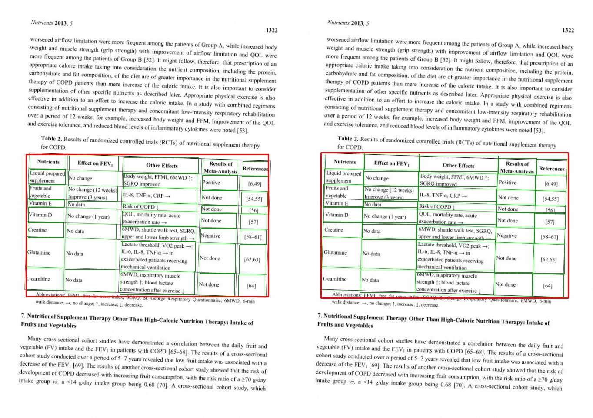
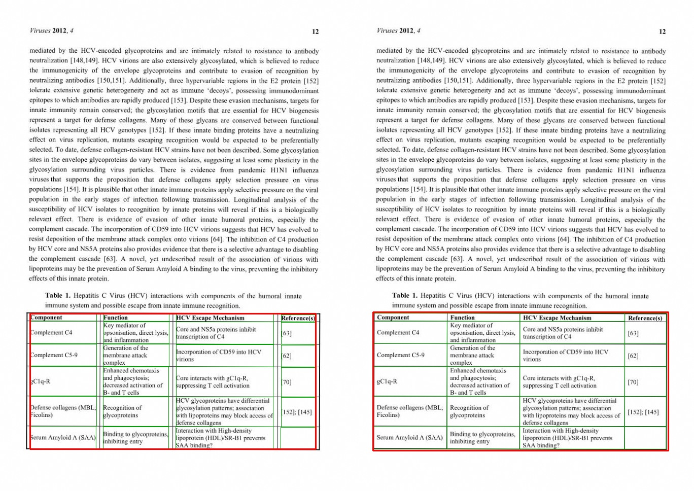
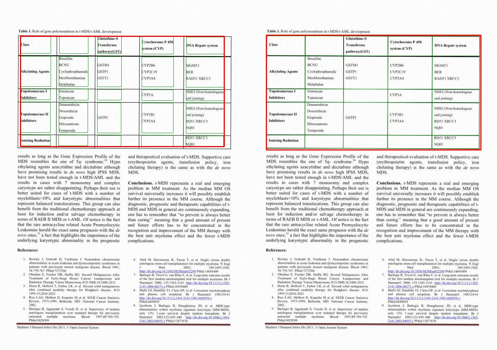
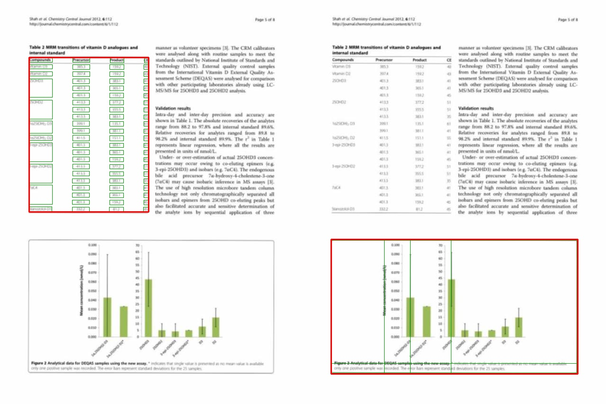
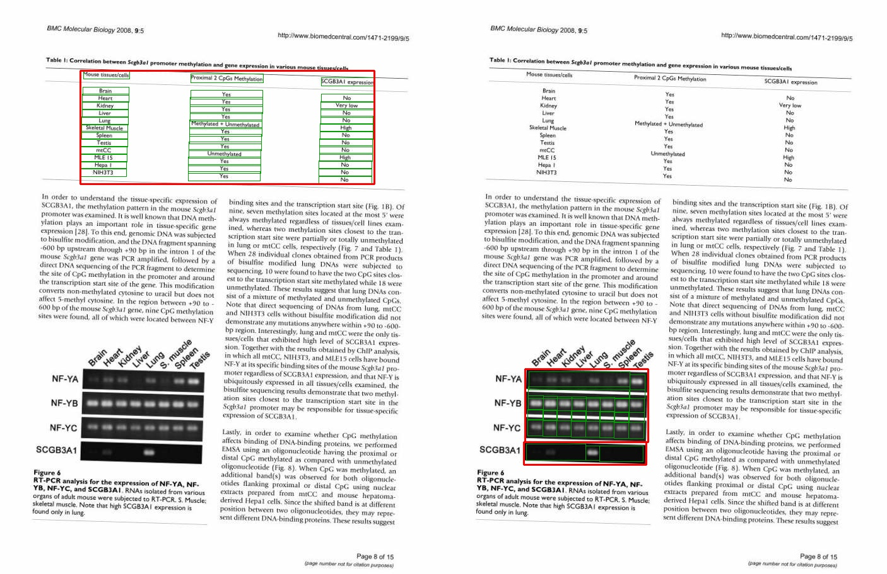
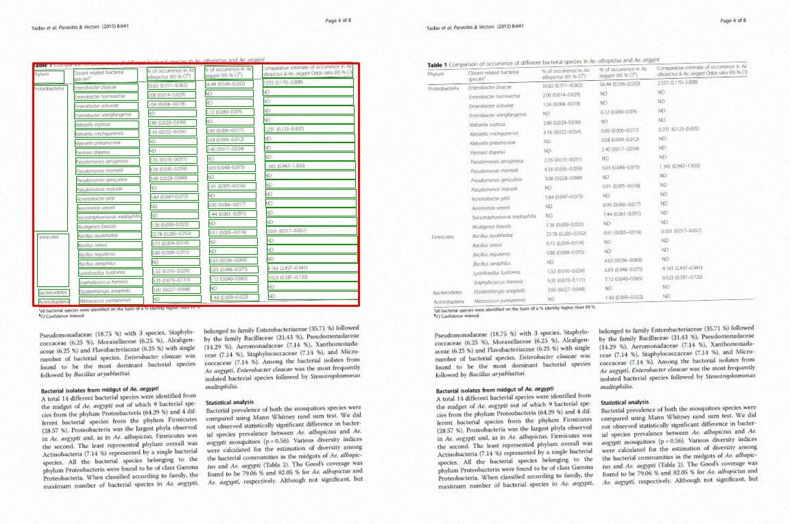

# Примеры из оценённого префикса 8476 train-страниц

Лучшие доступные результаты не обязательно полностью правильны; фактические метрики указаны под каждым примером.

## best: PMC3705350_6

TEDS=0.697176; TEDS-struct=0.959184; F1=0.101266. Слева эталон, справа baseline.

[Сравнение текста](best-PMC3705350_6-compare.html)

## best: PMC3280516_11

TEDS=0.605606; TEDS-struct=0.870968; F1=0.043478. Слева эталон, справа baseline.

[Сравнение текста](best-PMC3280516_11-compare.html)

## structure-success: PMC3219649_3

TEDS=0.479327; TEDS-struct=1.000000; F1=0.200000. Слева эталон, справа baseline.

[Сравнение текста](structure-success-PMC3219649_3-compare.html)

## error: PMC3505479_4

TEDS=0.000000; TEDS-struct=0.000000; F1=0.000000. Слева эталон, справа baseline.

[Сравнение текста](error-PMC3505479_4-compare.html)

## error: PMC2266941_7

TEDS=0.000000; TEDS-struct=0.000000; F1=0.000000. Слева эталон, справа baseline.

[Сравнение текста](error-PMC2266941_7-compare.html)

## missed: PMC4683861_3

TEDS=0.000000; TEDS-struct=0.000000; F1=0.000000. Слева эталон, справа baseline.

[Сравнение текста](missed-PMC4683861_3-compare.html)
